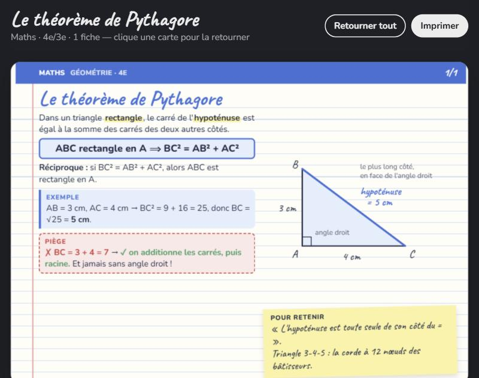
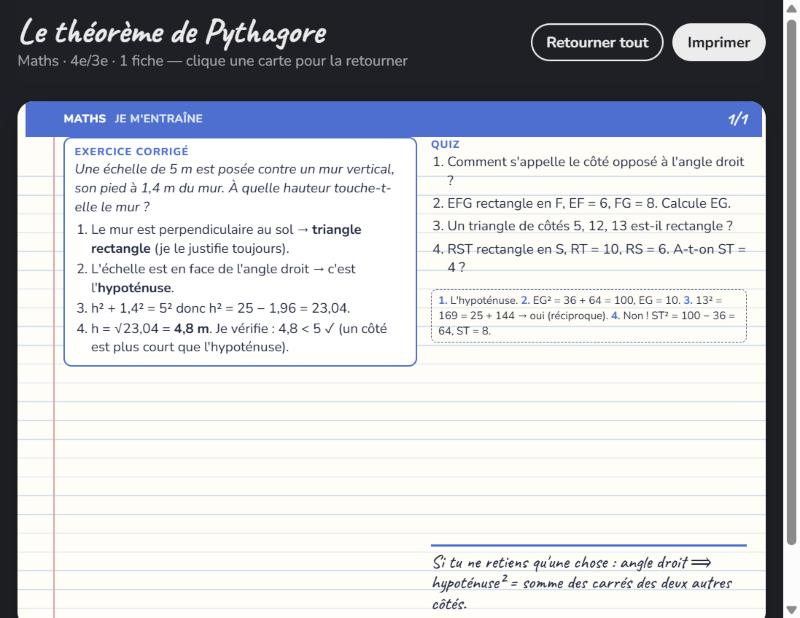

# 📇 Fiches Bristol — un skill Claude qui fait tes fiches de révision

Donne un chapitre à Claude (ou colle ton cours, un PDF, des photos) et il te rend de **vraies fiches bristol recto-verso**, rédigées comme par un excellent prof : l'essentiel, un schéma dessiné, un exemple, les pièges, un moyen mnémotechnique, un exercice corrigé et un quiz.

Toutes matières, du collège au supérieur. À imprimer en A5 ou à réviser sur ton téléphone.

| Recto — j'apprends | Verso — je m'entraîne |
|---|---|
|  |  |

👉 Exemple complet : [`exemples/fiches-pythagore.html`](exemples/fiches-pythagore.html) (télécharge-le et ouvre-le dans ton navigateur).

---

## ✨ Ce qu'il y a sur chaque fiche

**Recto**
- 🎨 Un bandeau de couleur par matière (maths, physique, SVT, histoire-géo, français, langues, philo, éco, info)
- 📌 **L'essentiel** : définition, règle ou formule, avec les mots-clés surlignés
- ✏️ **Un schéma SVG dessiné par Claude** : figure géométrique, courbe, frise chronologique, circuit, schéma annoté, carte mentale…
- 💡 **Un exemple** concret
- ⚠️ **Le piège** que les correcteurs voient le plus (« ✗ faux → ✓ juste »)
- 🟨 **Un moyen mnémotechnique** sur un post-it

**Verso**
- 📝 **Un exercice corrigé pas à pas**, avec le *pourquoi* de chaque étape
- ❓ **Un quiz** de 3 à 5 questions de difficulté croissante, réponses écrites à l'envers (floutées à l'écran, clique pour les voir)
- 🎯 « **Si tu ne retiens qu'une chose…** »

**En plus**
- Le niveau (collège, lycée, bac, supérieur) est deviné automatiquement.
- Si tu donnes ton cours, Claude s'en sert comme référence (mêmes notations, même vocabulaire).
- Une notion = une carte. Un long chapitre se termine par une carte bilan en carte mentale.
- Les cartes trop chargées sont détectées et corrigées avant de te les donner.

---

## 🚀 Installation

### Sur claude.ai (le plus simple)

1. Télécharge ce dépôt : bouton vert **Code → Download ZIP**, puis décompresse-le.
2. Compresse **uniquement le dossier `fiches-bristol/`** en `fiches-bristol.zip` (clic droit → Compresser / Envoyer vers → Dossier compressé).
3. Sur [claude.ai](https://claude.ai) : **Paramètres → Fonctionnalités → Skills → Importer un skill**, et choisis `fiches-bristol.zip`.
   - Si tu ne vois pas « Skills », active d'abord **l'exécution de code et la création de fichiers** dans la même page.

> 💡 Si une version `.zip` est disponible dans l'onglet **Releases** de ce dépôt, télécharge-la directement et passe à l'étape 3.

### Dans Claude Code (CLI ou appli desktop)

**Windows (PowerShell)**
```powershell
git clone https://github.com/Sno0ok/skill-fiches-bristol.git
Copy-Item -Recurse skill-fiches-bristol\fiches-bristol "$env:USERPROFILE\.claude\skills\"
```

**macOS / Linux**
```bash
git clone https://github.com/Sno0ok/skill-fiches-bristol.git
mkdir -p ~/.claude/skills && cp -r skill-fiches-bristol/fiches-bristol ~/.claude/skills/
```

Redémarre Claude Code : le skill apparaît sous le nom `fiches-bristol`.

---

## 💬 Utilisation

Parle normalement à Claude, par exemple :

- « Fais-moi des fiches sur la photosynthèse, niveau seconde »
- « Transforme ce cours en fiches bristol » (+ ton PDF ou tes photos)
- « Fiches de révision sur la Guerre froide pour le bac »
- « J'ai un partiel de thermo demain, fais-moi 5 fiches sur les cycles »

Dans Claude Code tu peux aussi taper `/fiches-bristol`.

Tu reçois :
- un fichier **HTML** (`fiches-<sujet>.html`) à ouvrir dans ton navigateur ;
- quand c'est possible, une **page Artifact** à consulter sur ton téléphone.

**À l'écran** : clique une carte pour la retourner, clique les réponses pour les dévoiler.

**Pour imprimer** : `Ctrl+P` (ou `Cmd+P`), puis :
- Format **A5 paysage**
- Marges **aucune**
- **Recto-verso, retourner sur le bord court**
- Cocher **Graphiques d'arrière-plan**

Imprime sur du bristol A5, ou sur de l'A4 coupé en deux.

---

## 🗂️ Contenu du dépôt

```
fiches-bristol/          ← le skill (c'est ce dossier qu'on installe)
├── SKILL.md             ← la méthode du « prof » : découpage, rédaction, schémas, vérifications
└── template.html        ← le gabarit visuel des cartes (CSS, retournement, impression, contrôle de débordement)
exemples/
└── fiches-pythagore.html
docs/                    ← captures d'écran du README
```

## 🛠️ Personnaliser

- **Le ton, le contenu, la longueur** : modifie `fiches-bristol/SKILL.md`.
- **Le look** (couleurs, polices, papier ligné) : modifie le `<style>` de `fiches-bristol/template.html`. Les couleurs par matière sont dans les règles `[data-matiere="…"]`.
- Pour ajouter une matière : ajoute une ligne `[data-matiere="ma-matiere"]{--accent:#…; --accent-pale:#…}`.

## ⚠️ Bon à savoir

- Claude peut se tromper : relis tes fiches, surtout les dates, chiffres et formules. Donner ton propre cours réduit fortement les erreurs.
- Les polices viennent de Google Fonts : hors ligne, le navigateur utilise une police de secours.

## 📄 Licence

[MIT](LICENSE) : utilise, modifie et partage librement.
